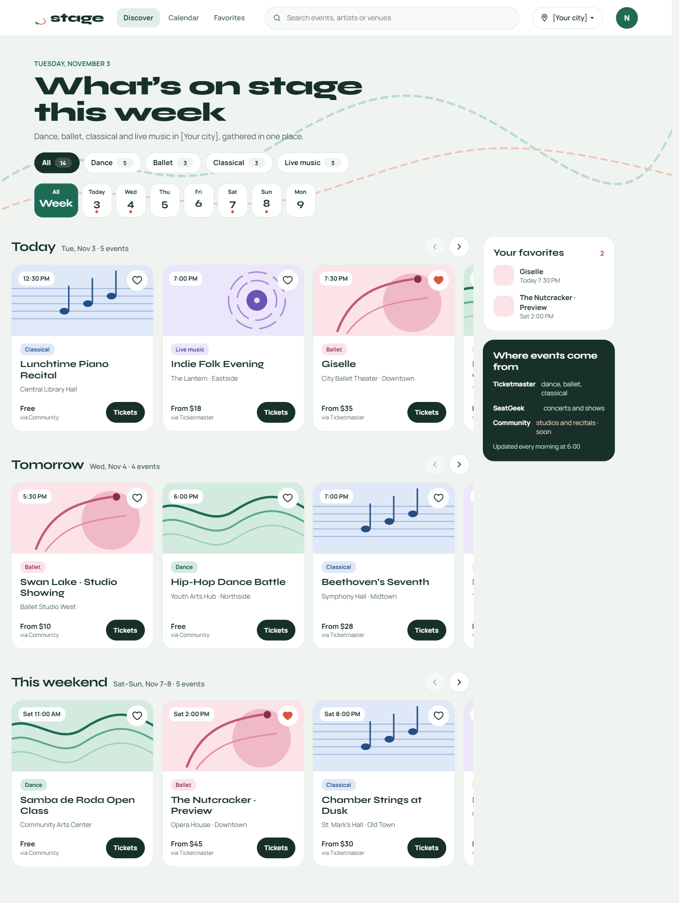
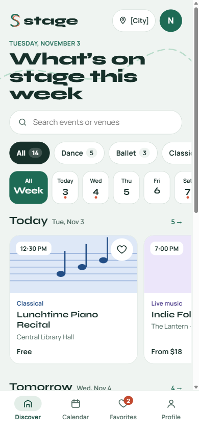
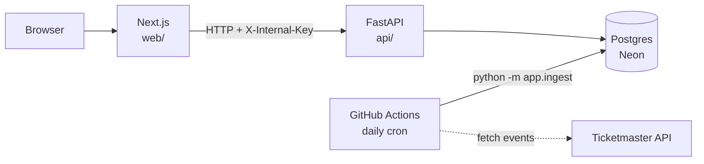

# Stage

**Dance, ballet, classical and live music events in Tampa, in one calm feed.**

Stage pulls events from several sources (Ticketmaster now, with SeatGeek and community posts planned), keeps only the arts events and groups them into **Today**, **Tomorrow** and **This weekend**. You can search, filter by category and save favorites after signing in with Google.

> Status: work in progress (Phase 1, MVP).

<p>
  
  
</p>

## Stack

| Part | Tech | Hosting |
|---|---|---|
| Frontend | Next.js (App Router), TypeScript, Tailwind CSS, Auth.js (Google) | Vercel |
| Backend | Python 3.12, FastAPI, SQLAlchemy 2, Alembic, httpx, pytest | Render (Docker) |
| Database | PostgreSQL | Neon |
| Data source | Ticketmaster Discovery API | — |
| Jobs / CI | GitHub Actions (daily ingest + tests on every push) | GitHub |

## Architecture



- The browser only talks to Next.js. Next.js calls FastAPI from the server, so the API URL and the internal key never reach the browser and CORS isn't needed.
- Only the API talks to the database.
- The ingest job runs as a CLI on a schedule. It is not a public endpoint.

## Repository layout

```
stage/
├─ web/            Next.js app
├─ api/            FastAPI app (app/, alembic/, tests/, Dockerfile)
├─ design/         Screen exports
├─ docker-compose.yml   Local Postgres for tests
└─ .github/workflows/   ci.yml, ingest.yml
```

## Getting started

### Prerequisites

- Python 3.12
- Node.js 20+
- Docker (for the local test database)

### Environment variables

Each app has its own template. Copy it and fill in the values:

```bash
cp api/.env.example api/.env
cp web/.env.example web/.env.local
```

`INTERNAL_API_KEY` must have the same value in both files.

### API

_TODO (Step 1)_

### Web

_TODO (Step 5)_

### Tests

_TODO (Step 4 / Step 6)_

## Data attribution

Event data comes from the [Ticketmaster Discovery API](https://developer.ticketmaster.com/). Every "Tickets" link points to the event's own Ticketmaster page.
